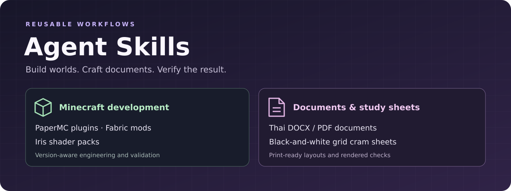
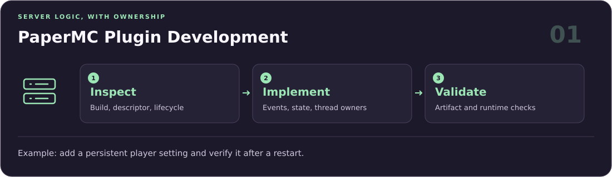
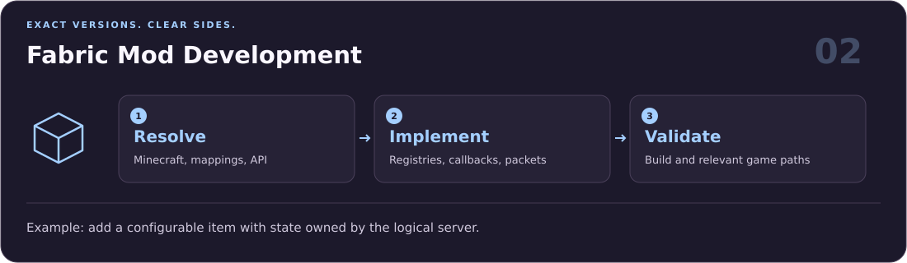
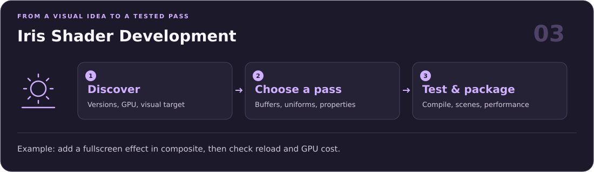
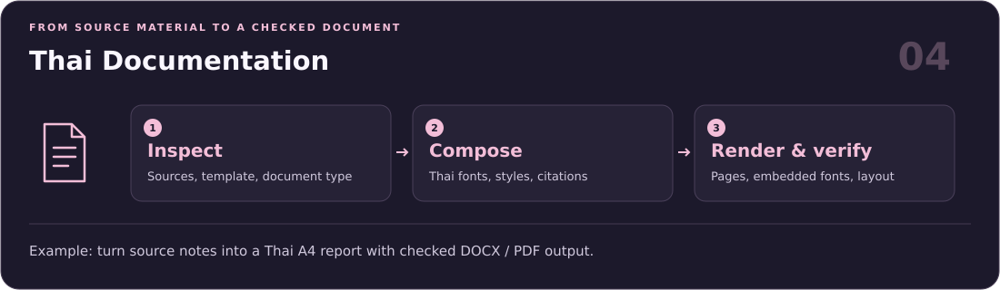
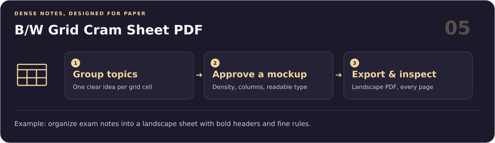

# Agent Skills

**English** · [ภาษาไทย](README.th.md)

Reusable agent skills for Minecraft development, Thai documents, and print-ready PDFs. Small, composable workflows grounded in each task's actual constraints.



## Quickstart

Install the skills into your project with the [skills.sh](https://skills.sh/) installer:

```bash
npx skills@latest add tantaihaha4487/skills
```

Select the skills and coding agents you want during installation. To install all skills for Codex automatically:

```bash
npx skills@latest add tantaihaha4487/skills --agent codex --skill '*' --yes
```

<details>
<summary>Install one skill at a time</summary>

Install a single skill by name:

```bash
npx skills@latest add tantaihaha4487/skills --skill papermc-plugin-development
npx skills@latest add tantaihaha4487/skills --skill fabric-mod-development
npx skills@latest add tantaihaha4487/skills --skill iris-shader-development
npx skills@latest add tantaihaha4487/skills --skill thai-docs
npx skills@latest add tantaihaha4487/skills --skill bw-grid-pdf
```

</details>

Use `--global` with `--agent codex` to install them in your user-level Codex skills directory.

## Find your workflow

| Build & develop | Write & study |
| --- | --- |
| [PaperMC plugins](#papermc-plugin-development) | [Thai documents](#thai-documentation) |
| [Fabric mods](#fabric-mod-development) | [B/W grid cram sheets](#bw-grid-cram-sheet-pdf) |
| [Iris shaders](#iris-shader-development) | |

The diagrams below illustrate each workflow. Example prompts are starting points; actual output and validation depend on your project and available tools.

### PaperMC Plugin Development



[`papermc-plugin-development`](skills/minecraft/papermc-plugin-development/SKILL.md) helps analyze, design, implement, debug, test, migrate, and maintain PaperMC plugins, including Folia-compatible projects.

**Try it:**

> Add a persistent player setting to this Paper plugin. Inspect the target versions and thread ownership, then verify the setting survives a restart.

### Fabric Mod Development



[`fabric-mod-development`](skills/minecraft/fabric-mod-development/SKILL.md) helps analyze, implement, debug, test, and migrate Fabric Minecraft mods while preserving exact Minecraft, mappings, Loader, Loom, and Fabric API compatibility.

**Try it:**

> Add a configurable item to this Fabric mod using its existing registration pattern. Keep game state on the logical server and validate the affected paths.

### Iris Shader Development



[`iris-shader-development`](skills/minecraft/iris-shader-development/SKILL.md) covers version-aware Minecraft shader-pack development for Iris with Sodium, including gbuffers, shadows, deferred/composite/final passes, shader properties, buffer formats, compatibility debugging, performance, and packaging.

**Try it:**

> Add a fullscreen effect to this Iris pack. Choose the right pass, declare its buffers, and check shader compilation, reload behavior, and GPU cost.

### Thai Documentation



[`thai-docs`](skills/productivity/thai-docs/SKILL.md) combines Thai DOCX/PDF creation with rigorous verification: A4 and margin checks, Thai font binding and embedding, LibreOffice export, text extraction, citation checks, and rendered-page inspection.

**Try it:**

> Turn these notes into a Thai A4 report and provide DOCX and PDF files. Follow the supplied template and verify the rendered layout and embedded fonts.

### B/W Grid Cram Sheet PDF



[`bw-grid-pdf`](skills/productivity/bw-grid-pdf/SKILL.md) produces dense, print-friendly landscape PDFs in pure black-and-white with a CSS Grid layout — ideal for cram sheets, cheat sheets, quick references, and study notes.

**Try it:**

> Turn these exam notes into a black-and-white landscape cram sheet. Show a layout mockup first, then export a readable grid PDF and inspect every page.

## What to expect

The engineering skills inspect the repository and exact dependencies before making changes. Document skills follow the requested format and check rendered output. Each workflow reports what was verified and what still needs testing.

## License

MIT
