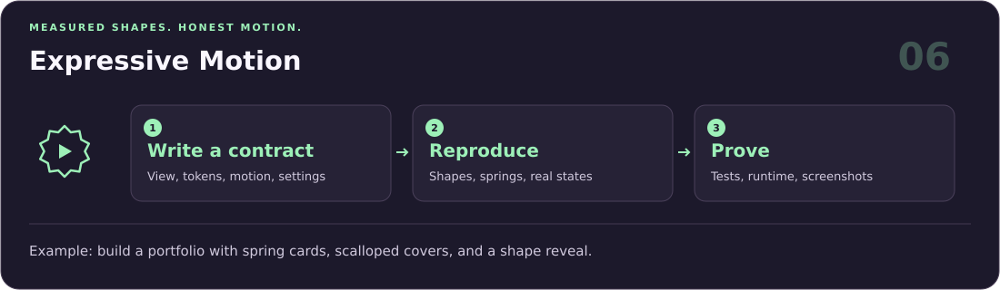
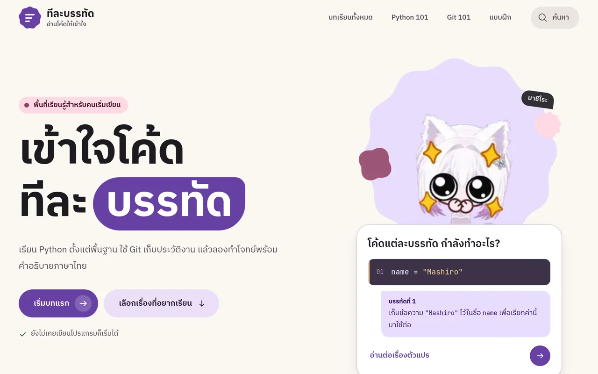
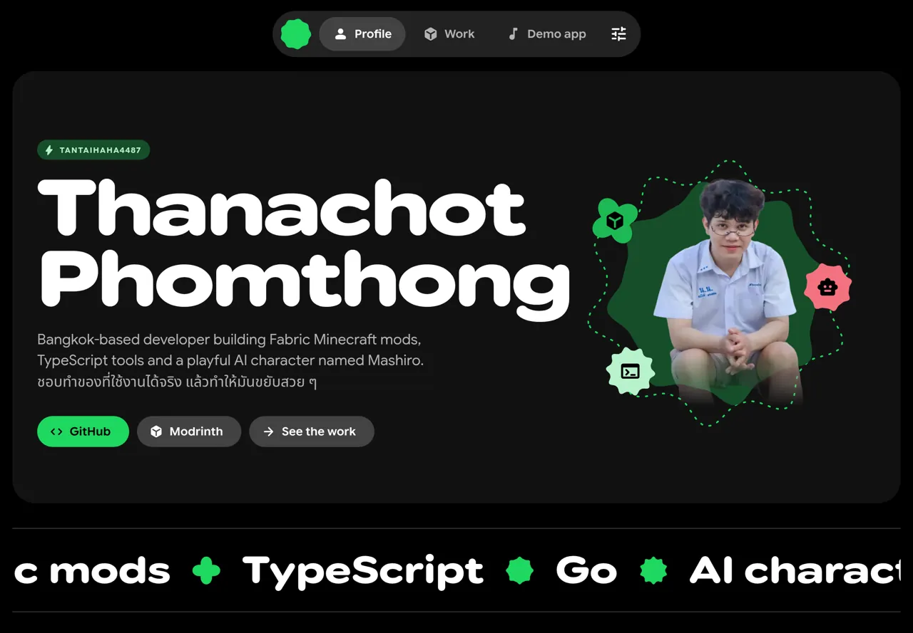

# Agent Skills

[English](README.md) · **ภาษาไทย**

ชุดทักษะสำหรับ AI agent เพื่อพัฒนา Minecraft ออกแบบ UI แบบ expressive จัดทำเอกสารภาษาไทย และสร้าง PDF พร้อมพิมพ์ แต่ละทักษะเป็นเวิร์กโฟลว์ที่นำไปใช้แยกกันได้ โดยยึดข้อกำหนดและหลักฐานจากงานจริง


## เริ่มใช้งาน

ติดตั้งทักษะลงในโปรเจกต์ผ่าน [skills.sh](https://skills.sh/):

```bash
npx skills@latest add tantaihaha4487/skills
```

เลือกรายการทักษะและ coding agent ระหว่างติดตั้ง หรือติดตั้งทุกทักษะสำหรับ Codex โดยอัตโนมัติ:

```bash
npx skills@latest add tantaihaha4487/skills --agent codex --skill '*' --yes
```

<details>
<summary>ติดตั้งทีละทักษะ</summary>

ระบุชื่อทักษะที่ต้องการ:

```bash
npx skills@latest add tantaihaha4487/skills --skill papermc-plugin-development
npx skills@latest add tantaihaha4487/skills --skill fabric-mod-development
npx skills@latest add tantaihaha4487/skills --skill iris-shader-development
npx skills@latest add tantaihaha4487/skills --skill thai-docs
npx skills@latest add tantaihaha4487/skills --skill bw-grid-pdf
npx skills@latest add tantaihaha4487/skills --skill expressive-motion
```

</details>

เพิ่ม `--global` ร่วมกับ `--agent codex` เพื่อติดตั้งลงในโฟลเดอร์ทักษะ Codex ระดับผู้ใช้

## เลือกเวิร์กโฟลว์

| พัฒนาเกม | จัดทำเอกสารและสื่ออ่านทบทวน | ออกแบบ |
| --- | --- | --- |
| [ปลั๊กอิน PaperMC](#ปลั๊กอิน-papermc) | [เอกสารภาษาไทย](#เอกสารภาษาไทย) | [UI และ motion แบบ expressive](#ui-และ-motion-แบบ-expressive) |
| [ม็อด Fabric](#ม็อด-fabric) | [ชีทสรุปขาวดำแบบตาราง](#ชีทสรุปขาวดำแบบตาราง) | |
| [เชดเดอร์ Iris](#เชดเดอร์-iris) | | |

ภาพด้านล่างอธิบายขั้นตอนการทำงาน ตัวอย่างคำสั่งใช้เป็นจุดเริ่มต้นได้ ผลลัพธ์และการตรวจสอบจริงขึ้นอยู่กับโปรเจกต์และเครื่องมือที่มี ภาพใช้ข้อความภาษาอังกฤษและมีคำอธิบายภาษาไทยกำกับแต่ละทักษะ

### ปลั๊กอิน PaperMC


[`papermc-plugin-development`](skills/minecraft/papermc-plugin-development/SKILL.md) ช่วยวิเคราะห์ ออกแบบ พัฒนา แก้บั๊ก ทดสอบ ย้ายเวอร์ชัน และดูแลปลั๊กอิน PaperMC รวมถึงงานที่ต้องรองรับ Folia โดยตรวจวงจรชีวิตและเจ้าของเธรดก่อนแก้โค้ด

**ขั้นตอน:** สำรวจบิลด์และ descriptor → พัฒนา event สถานะ และการทำงานบนเธรดที่ถูกต้อง → ตรวจไฟล์ปลั๊กอินและทดสอบบนเซิร์ฟเวอร์

**ลองสั่ง:**

> เพิ่มการตั้งค่ารายผู้เล่นที่บันทึกถาวรให้ปลั๊กอิน Paper นี้ ตรวจเวอร์ชันและเจ้าของเธรดก่อน แล้วทดสอบว่าค่ายังอยู่หลังรีสตาร์ตเซิร์ฟเวอร์

### ม็อด Fabric


[`fabric-mod-development`](skills/minecraft/fabric-mod-development/SKILL.md) ช่วยวิเคราะห์ พัฒนา แก้บั๊ก ทดสอบ และย้ายเวอร์ชันม็อด Fabric โดยรักษารูปแบบของโปรเจกต์และความเข้ากันได้ของ Minecraft, mappings, Loader, Loom และ Fabric API

**ขั้นตอน:** ตรวจเวอร์ชันและ dependency → พัฒนา registry, callback และ packet โดยแยกฝั่งให้ชัด → ตรวจบิลด์และเส้นทางการทำงานในเกมที่เกี่ยวข้อง

**ลองสั่ง:**

> เพิ่มไอเทมที่ปรับค่าผ่าน config ได้ให้ม็อด Fabric นี้ ใช้รูปแบบลงทะเบียนเดิม ให้ logical server เป็นเจ้าของสถานะเกม และตรวจเส้นทางการทำงานที่ได้รับผลกระทบ

### เชดเดอร์ Iris


[`iris-shader-development`](skills/minecraft/iris-shader-development/SKILL.md) ครอบคลุมการพัฒนา shader pack สำหรับ Iris ร่วมกับ Sodium ตั้งแต่ gbuffers, shadow, deferred, composite และ final ไปจนถึง properties, buffer formats การแก้ปัญหาความเข้ากันได้ และประสิทธิภาพ

**ขั้นตอน:** ตรวจเวอร์ชัน GPU และภาพที่ต้องการ → เลือก pass และประกาศ buffer/uniform → ทดสอบการคอมไพล์ ฉากต่าง ๆ การโหลดใหม่ และประสิทธิภาพก่อนแพ็ก

**ลองสั่ง:**

> เพิ่มเอฟเฟกต์เต็มหน้าจอให้ Iris pack นี้ เลือก pass ที่เหมาะสม ประกาศ buffer ที่ใช้ แล้วตรวจการคอมไพล์ การโหลดเชดเดอร์ใหม่ และภาระของ GPU

### เอกสารภาษาไทย


[`thai-docs`](skills/productivity/thai-docs/SKILL.md) ช่วยสร้างและตรวจเอกสาร DOCX/PDF ภาษาไทย ทั้งเรียงความ รายงาน และเอกสารราชการ พร้อมตรวจขนาด A4 ระยะขอบ ฟอนต์ไทย การฝังฟอนต์ การส่งออก PDF การอ้างอิง และภาพเรนเดอร์แต่ละหน้า

**ขั้นตอน:** ตรวจต้นฉบับ แม่แบบ และประเภทเอกสาร → จัดฟอนต์ รูปแบบ และการอ้างอิง → ตรวจจำนวนหน้า ฟอนต์ที่ฝัง และการจัดวางจากไฟล์เรนเดอร์

**ลองสั่ง:**

> เปลี่ยนโน้ตนี้เป็นรายงานภาษาไทยขนาด A4 พร้อมไฟล์ DOCX และ PDF ทำตามแม่แบบที่แนบ และตรวจการจัดวางหน้ากับฟอนต์ที่ฝังใน PDF

### ชีทสรุปขาวดำแบบตาราง


[`bw-grid-pdf`](skills/productivity/bw-grid-pdf/SKILL.md) สร้างชีทสรุป PDF แนวนอนสำหรับอ่านทบทวนและพิมพ์ ใช้ขาวดำล้วน จัดเนื้อหาด้วย CSS Grid หัวข้อหนา เนื้อหาน้ำหนักบาง และเส้นแบ่งช่อง เหมาะกับสรุปสอบ คู่มือย่อ และโน้ตอ้างอิง

**ขั้นตอน:** จัดแต่ละแนวคิดลงกลุ่มหัวข้อ → ดูตัวอย่างและตกลงความหนาแน่น คอลัมน์ และขนาดตัวอักษร → ส่งออก PDF แนวนอนและตรวจทุกหน้า

**ลองสั่ง:**

> ทำโน้ตเตรียมสอบนี้เป็นชีทสรุปขาวดำแนวนอน แสดงตัวอย่างการจัดวางก่อน แล้วส่งออก PDF แบบตารางที่อ่านได้ชัดเจนและตรวจทุกหน้า

### UI และ motion แบบ expressive



[`expressive-motion`](skills/design/expressive-motion/SKILL.md) นำสไตล์ Material 3 Expressive ที่วัดค่ามาแล้วไปใช้กับ UI ได้ทุกแพลตฟอร์ม มีทั้งค่า rounding ขนาด และตัวอักษรที่แน่นอน ชั้นสีตาม role แคตตาล็อกรูปทรง 37 แบบ spring ที่วัดจาก Qt ขอบปกแบบหยักและเส้นคลื่น การเปิดหน้าผ่านรูปทรงที่ขยายออก และนโยบายการตั้งค่าที่ reduced motion หยุดแค่แอนิเมชันวนเอง แต่ยังคงการตอบสนองต่อการกด มาพร้อม adapter สำหรับเว็บและ QML ตัวส่งออก token และเทสต์แบบออฟไลน์ และจะให้เขียน parity contract สั้น ๆ ก่อนแก้หน้าจอทุกครั้ง

**ขั้นตอน:** เขียน contract ระบุหน้าจอ token motion และการตั้งค่า → สร้างรูปทรง spring และสถานะจริง → ตรวจด้วยเทสต์ การรันในเบราว์เซอร์ และภาพหน้าจอ

**ผลงานที่ใช้ทักษะนี้:**

| [ทีละบรรทัด](https://teelabandat.vercel.app/) · บทเรียนเขียนโค้ดภาษาไทย | พอร์ตโฟลิโอ · [ลิงก์ชั่วคราว](https://vaulted-canoe-c2v7k.ship.place/portfolio.html) |
| --- | --- |
|  |  |

ทีละบรรทัดใช้สไตล์นี้กับพาเลตสีม่วงของแบรนด์ตัวเอง ส่วนพอร์ตโฟลิโอเป็นหน้าเว็บไฟล์เดียวที่สร้างจาก web adapter ของทักษะ ลิงก์พอร์ตโฟลิโอเป็นลิงก์ชั่วคราวและหมดอายุวันที่ 23 ตุลาคม 2026

**ลองสั่ง:**

> ทำหน้า landing นี้ใหม่ด้วยสไตล์ expressive-motion เขียน parity contract ก่อน ใช้ motion token ที่ส่งออกและ spring ที่วัดค่าไว้ แล้วตรวจโหมด reduced motion และ performance ในเบราว์เซอร์

## สิ่งที่จะได้รับ

ทักษะด้านพัฒนาจะสำรวจโครงสร้างโปรเจกต์และ dependency ที่ใช้จริงก่อนแก้ไข ทักษะเอกสารจะยึดรูปแบบที่กำหนดและตรวจผลเรนเดอร์ ทักษะด้านออกแบบจะบันทึกทุกจุดที่ปรับให้เข้ากับแพลตฟอร์ม และแยกรายงานหลักฐานด้านโครงสร้าง การรันจริง และภาพ แต่ละเวิร์กโฟลว์จะรายงานสิ่งที่ตรวจสอบแล้วและส่วนที่ยังต้องทดสอบเพิ่มเติม

## สัญญาอนุญาต

MIT
